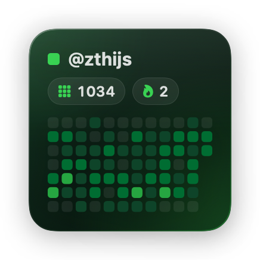
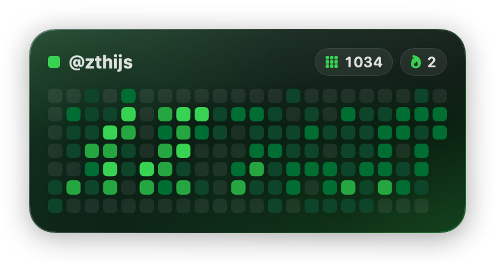

# CommitBox

A macOS desktop widget that shows your GitHub contribution graph, this year's total, and your current streak.

<p align="center">
  
  
</p>

## Download

**[Download CommitBox.zip](https://github.com/zthijs/commitbox/releases/download/latest/CommitBox.zip)** (latest build from `main`, requires macOS 26.7 or later)

## Install

1. Unzip and move `CommitBox.app` to `/Applications`.
2. The app isn't notarized, so remove the quarantine flag:
   ```sh
   xattr -dr com.apple.quarantine /Applications/CommitBox.app
   ```
3. Open CommitBox once, then right-click the desktop, choose **Edit Widgets** and add **GitHub Contributions**.
4. Right-click the widget, choose **Edit** and enter your GitHub username.
